

  <a href="https://daniel-vaz.github.io/overseer-console/">
    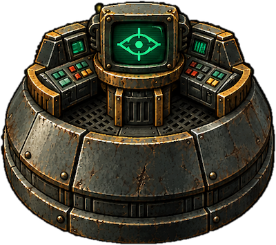
  </a>

<h1 align="center">Overseer Console</h1>

  <b>Fallout and Fallout 2, and their mods, in your browser.</b> 
  From your own copy of the games. Nothing to install, no server, no account.

  
  
  

  <a href="https://daniel-vaz.github.io/overseer-console/">
    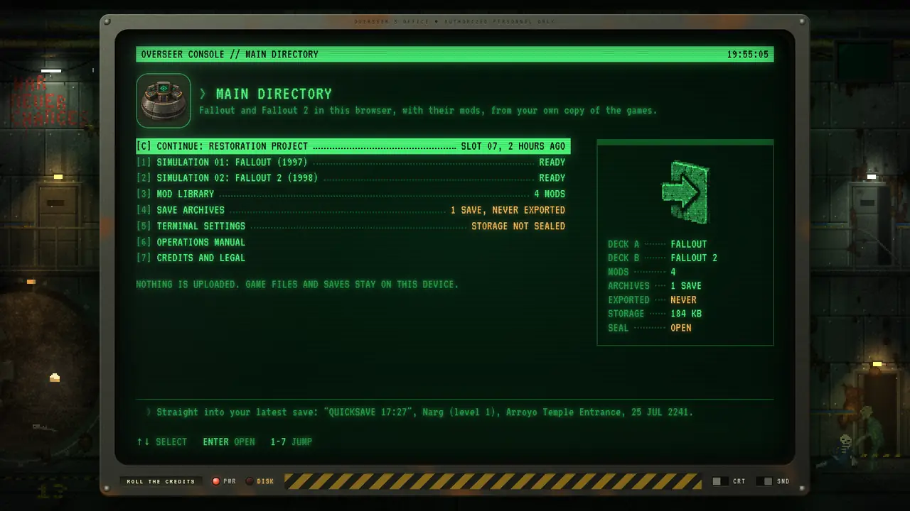
  </a>

  <a href="#two-games-and-their-mods">Games</a> ·
  <a href="#play-in-three-steps">Get started</a> ·
  <a href="#highlights">Highlights</a> ·
  <a href="docs/features.md">All features</a> ·
  <a href="#documentation">Docs</a> ·
  <a href="#credits">Credits</a>

Overseer Console is a vault terminal that runs the open source Community Edition engines of Fallout and Fallout 2,
compiled to WebAssembly. Point it at the folder Steam, GOG or Epic installed your game to: it copies the data into
your browser's private storage and plays from there, on a desktop, a tablet or a phone.

## Two games and their mods

<table>
  <tr>
    <td width="33%" align="center">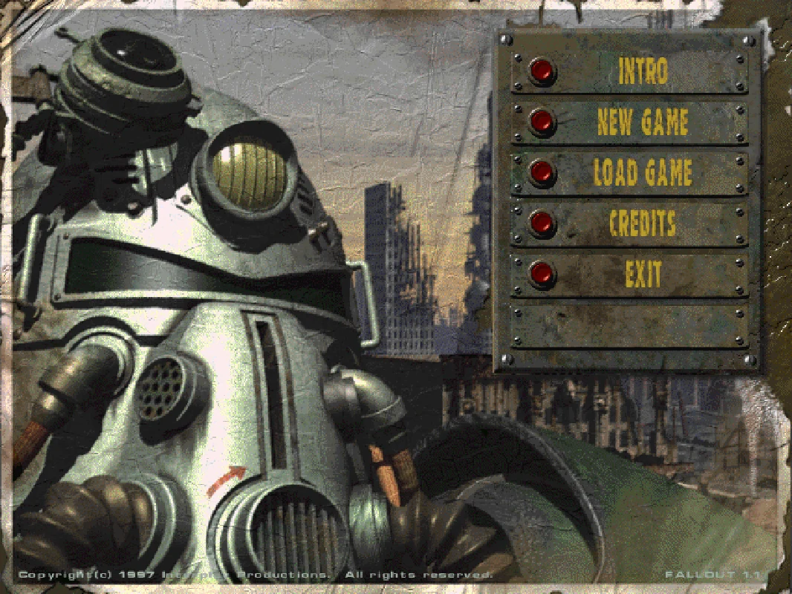</td>
    <td width="33%" align="center">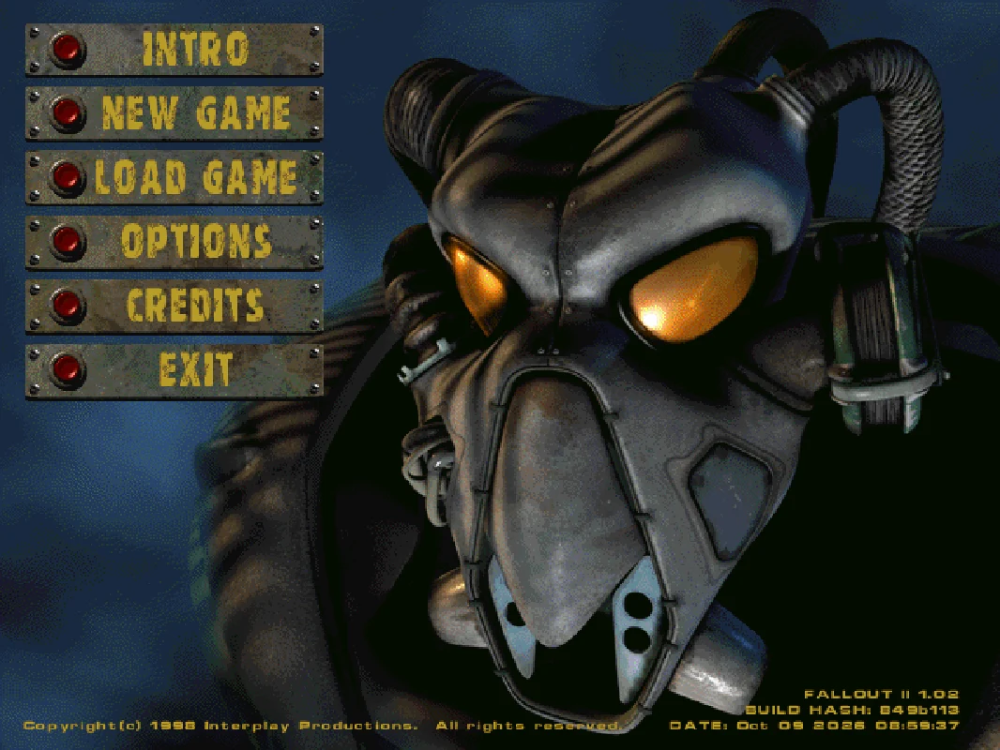</td>
    <td width="33%" align="center">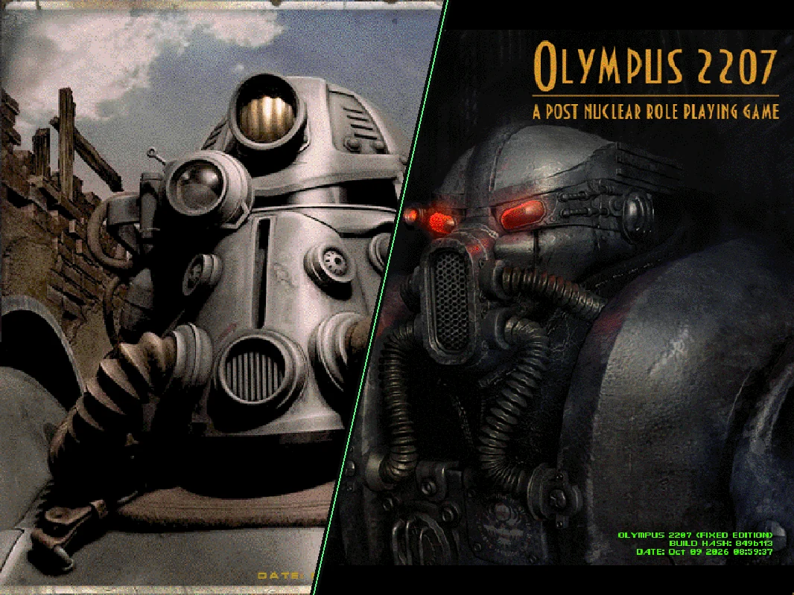</td>
  </tr>
  <tr>
    <td align="center"><b>Fallout</b> 1997, on Fallout Community Edition</td>
    <td align="center"><b>Fallout 2</b> 1998, on Fallout 2 Community Edition</td>
    <td align="center"><b>Their mods</b> Sonora and Olympus 2207 here, any other from its zip or folder</td>
  </tr>
</table>

Bring your own mods: whole new games on the old engines, restorations of what was cut, and fixes. Each is played on
the game it was made for, with saves of its own, from the console's Mod library. Nine are known by name (Sonora,
Nevada, Olympus 2207, Resurrection, Fallout Yesterday, the Restoration Project, the Megamod, Fallout Et Tu and Fallout
Fixt); any other loads from its zip or its folder. See [Mods](docs/mods.md).

## Play in three steps

1. **[Open the console](https://daniel-vaz.github.io/overseer-console/).** Any modern browser.
2. **Load a holodisk.** Pick your game's folder, drop it on the console, or hand it a zip of it. A mod goes into the
   Mod library, from the zip it is downloaded as or a game folder it was installed in.
3. **Press `1`.** Next time, `C` takes you straight back into your latest save.

You need to own the games ([GOG](https://www.gog.com/game/fallout), [Steam](https://store.steampowered.com/app/38400),
Epic). No game data is hosted or distributed here, and nothing is uploaded.

## Highlights

<table>
  <tr>
    <td width="55%">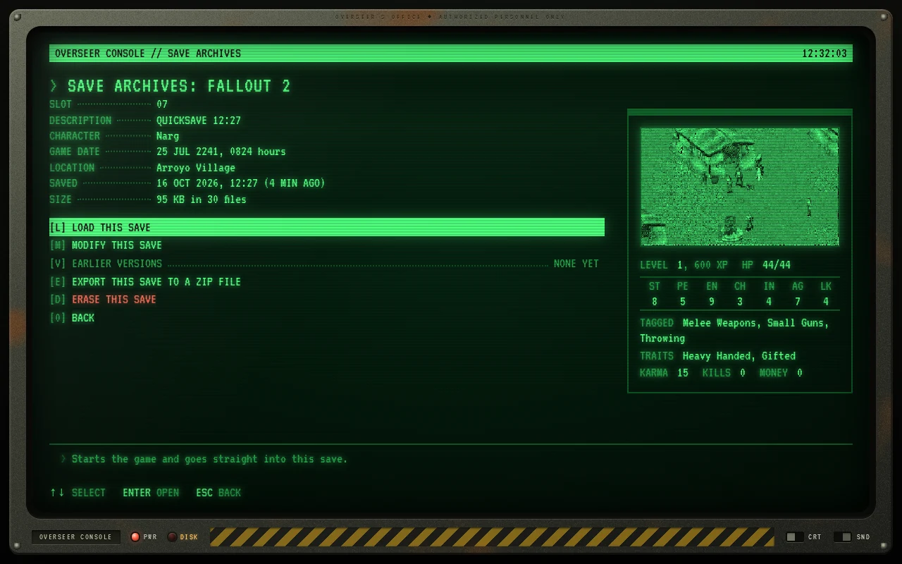</td>
    <td>
      <h3>Saves that don't get lost</h3>
      Every save shows its screenshot and character sheet, read from the save file itself. Autosave every ten
      minutes, quick save on <code>F6</code>, earlier versions of every slot to roll back to, erased saves kept
      for a week, zip export, and an optional link to your own <a href="docs/cloud-storage.md">cloud storage</a>
      to carry saves, games and mods between devices.
    </td>
  </tr>
  <tr>
    <td>
      <h3>Bring your own mods</h3>
      Hand the console a mod as it is downloaded, or a game folder it was installed in. It keeps only what differs
      from your game, does what the mod's installer would do, and plays it on that game's engine with saves of its
      own. Put it in the game's deck, switch its parts on and off, or go back to the game as it was sold with one key.
    </td>
    <td width="55%">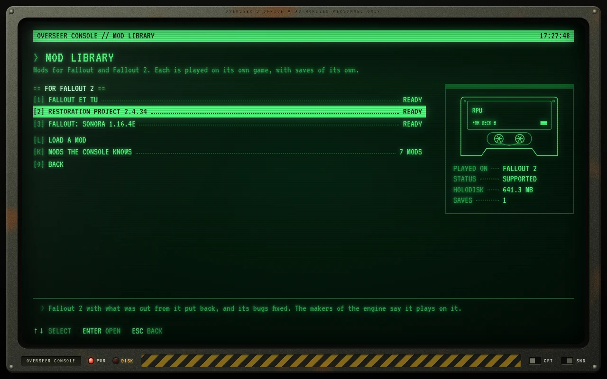</td>
  </tr>
  <tr>
    <td width="55%">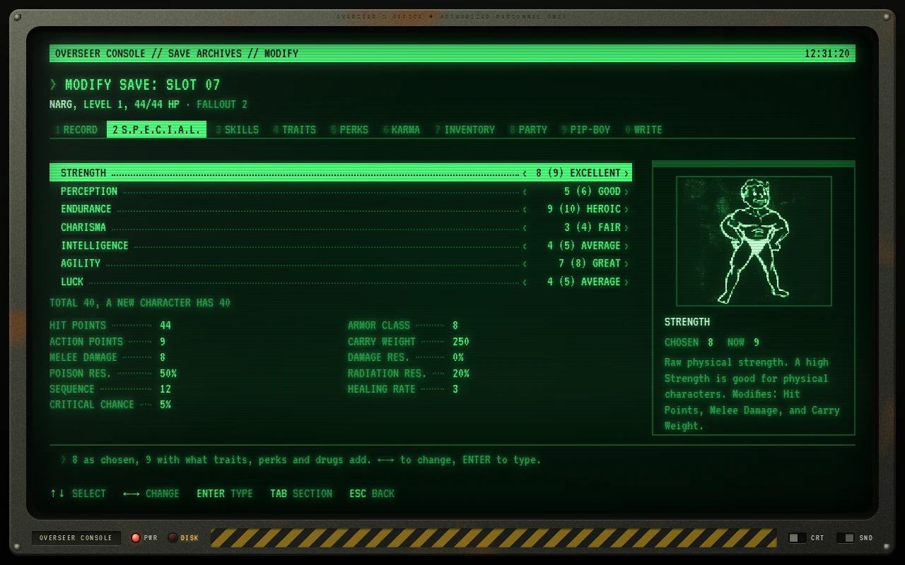</td>
    <td>
      <h3>A save editor that knows the rules</h3>
      Name, level, S.P.E.C.I.A.L., skills, traits, perks, inventory, karma, reputation, companions, quests, the
      world map and the date. Drawn with the game's own pictures, from your copy, and checked against the game's
      own rules. Every change can be undone.
    </td>
  </tr>
  <tr>
    <td>
      <h3>Made for touch screens too</h3>
      Tap, drag, hold and two-finger gestures stand in for the mouse. One-tap buttons open the inventory, map,
      character screen and Pip-Boy, end a turn, quick save and fast forward. A keyboard appears when the game asks
      for text.
    </td>
    <td width="55%">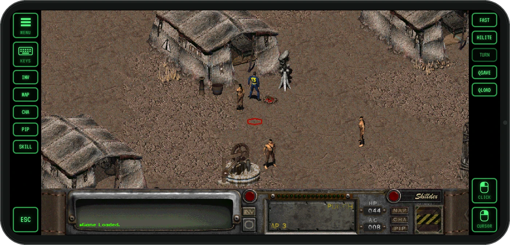</td>
  </tr>
  <tr>
    <td width="55%">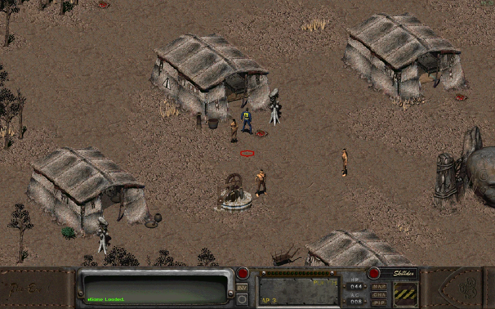</td>
    <td>
      <h3>Your picture, game by game</h3>
      The original 640 x 480, widened to your window, or high resolution. Fast forward with <code>F8</code> for the
      long walks and the turns of a dozen rats. Fallout 2's engine improvements can be switched on, or off for the
      original game.
    </td>
  </tr>
</table>

<table>
  <tr>
    <td width="33%">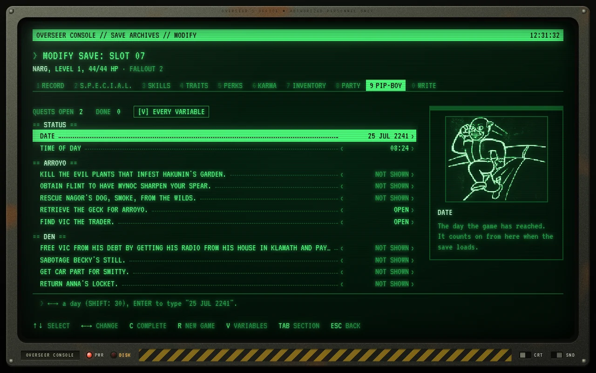</td>
    <td width="33%">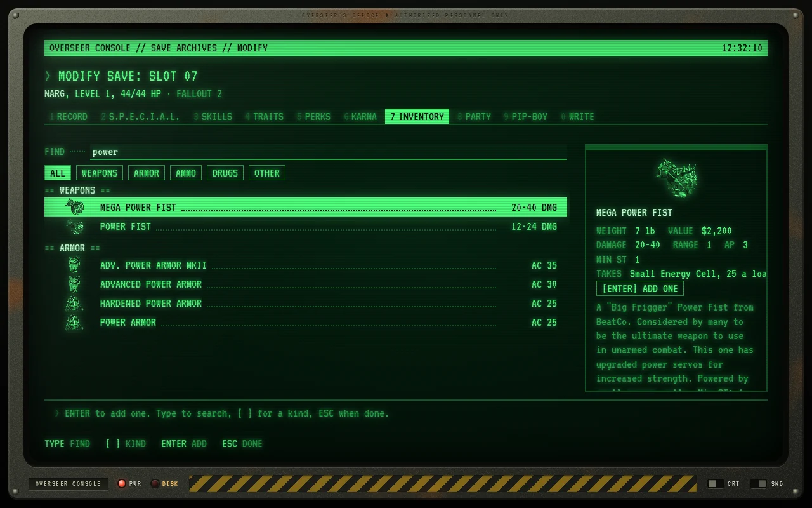</td>
    <td width="33%">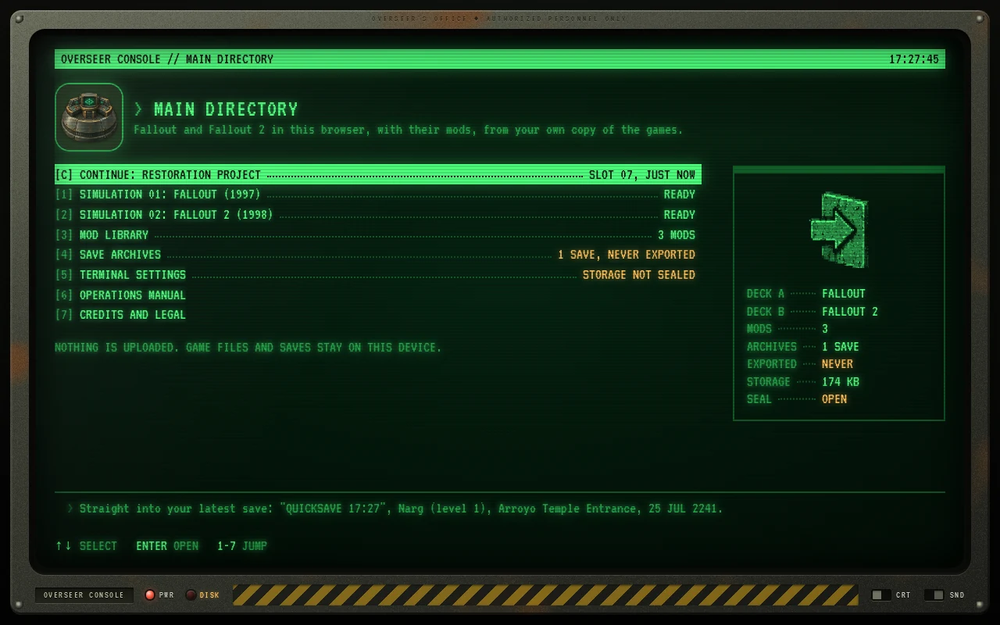</td>
  </tr>
  <tr>
    <td align="center">Quests, holodisks and the world map</td>
    <td align="center">Every item the game has, with its picture</td>
    <td align="center">Two decks, their mods, one key to continue</td>
  </tr>
</table>

### And the vault around it

On a screen with room to spare the console stands in an abandoned vault, painted live in the browser from nothing
but code. Lamps fail, a pipe drips, and now and then something walks past. Most of it answers to a click, its great
door is shut exactly when the console's storage is sealed, and a console left alone gets a visitor on its glass.

**[See everything it does →](docs/features.md)**

## Keys in the game

| Key | What it does |
| --- | --- |
| `F6` / `F7` | Quick save to slot 07, quick load from it |
| `F8` | Fast forward, on and off |
| `F9` | The console menu: the game and its clock stop |
| `F11` | Fullscreen |

## Documentation

| Guide | What it covers |
| --- | --- |
| [Features](docs/features.md) | Everything the console does |
| [Mods](docs/mods.md) | Loading a mod, playing it on its game, and the mods the console knows |
| [Cloud storage](docs/cloud-storage.md) | Carry saves, games and mods between devices through your own Dropbox or Google Drive |
| [How it works](docs/how-it-works.md) | The engines, storage, save reader and editor, and the vault |
| [Developing](docs/developing.md) | Building the engines and the site, tests, deploying |

The console's own **Operations manual** (entry `6` of the main directory) explains each of these from inside it.

> [!NOTE]
> This is an unofficial fan project. It is not affiliated with or endorsed by Bethesda Softworks,
> ZeniMax Media, Microsoft or Interplay. Fallout is a trademark of Bethesda Softworks LLC.

## Credits

The mods the console knows by name are the work of their makers, and of the many more their own credits name:
[Fallout: Sonora](https://cambragol.github.io/Fallout-Sonora/) and
[Fallout: Nevada](https://github.com/BGforgeNet/fallout-nevada-english-translation) of the Nevada Band (alposh),
translated by cambragol and others; [Olympus 2207](https://github.com/HogLord69/olympus-2207-english) of NEBESA
GAMES, rebuilt by Foxx and translated by HogLord69; [Fallout 1.5: Resurrection](https://resurrection.cz/en/) of the
Resurrection Team; [Fallout Yesterday](https://gitlab.com/falloutfans/fallouty) of PJ Hexer and its many
contributors; the
[Restoration Project](https://github.com/BGforgeNet/Fallout2_Restoration_Project) of Killap, carried on by BGforge;
the [Megamod](https://www.nma-fallout.com/resources/mib88-megamod.11/) of MIB88;
[Fallout Et Tu](https://github.com/rotators/Fo1in2) of Lexx, Wipe, Mayck and Ghosthack; and
[Fallout Fixt](https://www.moddb.com/mods/fallout-fixt) of Sduibek. None of them is included here.

The engines are the work of [alexbatalov](https://github.com/alexbatalov) and the contributors to
[fallout1-ce](https://github.com/alexbatalov/fallout1-ce) and
[fallout2-ce](https://github.com/fallout2-ce/fallout2-ce). The WebAssembly target of Fallout 2 CE
was contributed by [ololoken](https://github.com/ololoken); the first browser port of the engine
was made by [roginvs](https://github.com/roginvs/fallout2-ce). The movie decoder fix carried in
the Fallout 1 patches was first published by [K1ngst0m](https://github.com/K1ngst0m/fallout1-ce-web).

Both engines are published under the
[Sustainable Use License](https://github.com/alexbatalov/fallout1-ce/blob/main/LICENSE.md), which
allows free, non-commercial use and distribution. The builds served by this project are modified
copies; every build ships its licence and third-party notices next to the binary
(`public/engines/<id>/LICENSE.txt`, `THIRD-PARTY.txt`). Because of that licence this site must
stay free of charge and non-commercial.

Also built on SDL, Emscripten, zlib, fflate, Svelte and the VT323 typeface by Peter Hull.
