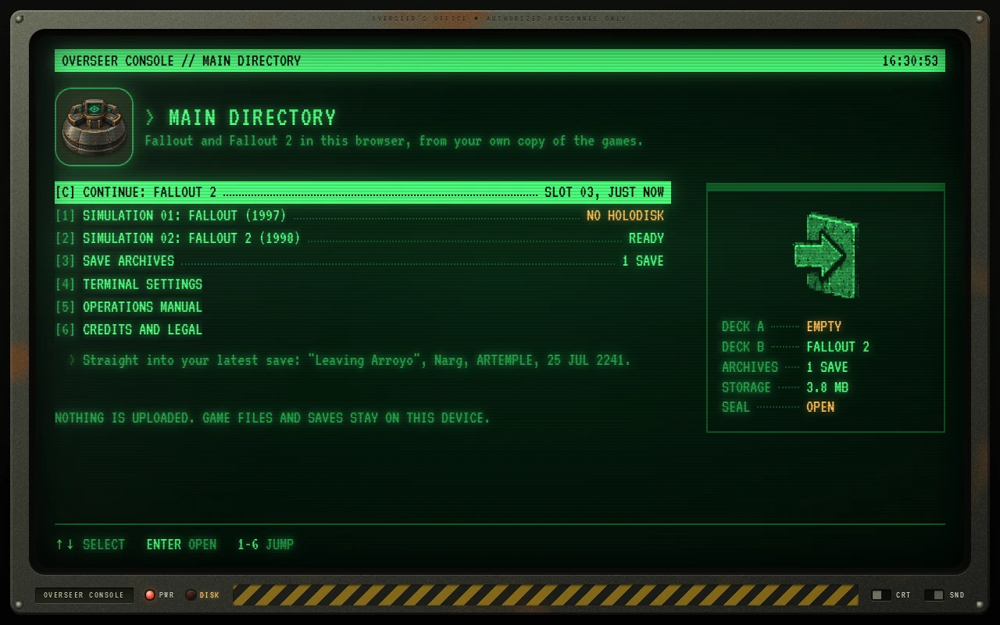

<p align="center">
  <a href="https://daniel-vaz.github.io/overseer-console/">
    
  </a>
</p>

<h1 align="center">Overseer Console</h1>

<p align="center">
  Play <b>Fallout</b>, <b>Fallout 2</b> and <b>Fallout Et Tu</b> in your browser, from your own copy of the games.
</p>

<p align="center">
  <a href="https://daniel-vaz.github.io/overseer-console/"></a>
  <a href="https://github.com/Daniel-Vaz/overseer-console/actions/workflows/deploy.yml"></a>
</p>

<p align="center">
  <a href="#features">Features</a> ·
  <a href="#how-it-works">How it works</a> ·
  <a href="#fallout-et-tu">Fallout Et Tu</a> ·
  <a href="#dropbox-link">Dropbox link</a> ·
  <a href="#developing">Developing</a> ·
  <a href="#deploying">Deploying</a> ·
  <a href="#credits">Credits</a>
</p>

<p align="center">
  <a href="https://daniel-vaz.github.io/overseer-console/">
    
  </a>
</p>

Overseer Console is a static web page styled as a vault terminal. It runs the open source
[Fallout Community Edition](https://github.com/alexbatalov/fallout1-ce) and
[Fallout 2 Community Edition](https://github.com/fallout2-ce/fallout2-ce) engines, compiled to
WebAssembly. You point it at the folder a store installed the game to; it copies the data files
into the browser's private storage on your device and plays from there. It also plays
[Fallout Et Tu](https://github.com/rotators/Fo1in2), the first game rebuilt for the engine of the second, which
it puts together in the browser from the two games and the conversion's own package.

## Features

- **Your own copy of the games.** No game data is hosted or distributed here. You need to own them
  ([GOG](https://www.gog.com/game/fallout), [Steam](https://store.steampowered.com/app/38400), Epic).
- **No server, no account, no tracking.** Nothing is uploaded, unless you link your own Dropbox: then the
  saves you choose to upload go to a folder in your Dropbox and nowhere else.
- **Saves as in the originals.** Saved games work as they always did, and can be exported to and imported
  from zip files.
- **A history for every slot.** Saving over a slot keeps what was in it: every slot has earlier versions to
  roll back to. An erased save is kept for a week, and can be put back.
- **Fallout Et Tu, put together for you.** Hand the console the zip the conversion is downloaded as. It takes
  the files Et Tu needs out of your Fallout and plays it on your Fallout 2: no unpacking, no extraction tool.
- **Games from a zip.** A game folder can be loaded as one zip of it, which is how a whole game, music
  included, gets onto a device that cannot pick folders.
- **Fast forward.** F8 runs a game several times as fast, for the long walk across a map and the turns of a
  dozen rats, and back again.
- **A picture for each game.** The original 640 x 480, widened to the shape of the window, or high resolution:
  chosen deck by deck, so Fallout Et Tu can have the picture it was laid out for while the originals keep theirs.
- **Fallout 2 with what its engine adds, or without.** One setting switches on items that light up on a key,
  a wider inventory, companions' own inventories, doors that open as you walk into them and more; switched
  off, the game plays as the original did.
- **Continue.** One key takes you from the console straight into your latest save.
- **Save archives.** They show each save's screenshot and character sheet, read from the save file itself, and
  name the place it was made in as the game does, from the game's own data.
- **Dropbox link, if you want one.** Carry saves between devices, and load a game from a folder in your own
  Dropbox (the way to get a game with its music onto a phone).
- **Touch screens.** Tap, drag, press-and-hold and two-finger gestures stand in for the mouse, with
  on-screen mouse buttons, one-tap shortcuts for the inventory, map, Pip-Boy, skilldex and the end of a
  turn, and a keyboard that appears when a game asks for text.
- **A vault around it.** On a screen with room to spare the console stands in an abandoned vault:
  lamps that fail, a pipe that drips, and now and then something that walks past. Most of it answers
  to being clicked, its great door is shut exactly when the console's storage is sealed, and a console
  left alone gets a visitor on its glass.

> [!NOTE]
> This is an unofficial fan project. It is not affiliated with or endorsed by Bethesda Softworks,
> ZeniMax Media, Microsoft or Interplay. Fallout is a trademark of Bethesda Softworks LLC.

## How it works

| Part | Where | What it does |
| --- | --- | --- |
| Engines | `engines/` | Pins an upstream commit of each engine, applies patches (Fallout 1 only), and compiles to WebAssembly inside the official Emscripten container. The Fallout 2 engine's own data folder is packed into `ce.dat` beside it. |
| Engine glue | `engines/lib/overseer.js` | Linked into both engines. Gives them a clock that can pause and run fast, hands the thread back to the browser during long loops, reads game archives from disk on demand, and reports file changes in batches. |
| Game data store | `src/lib/storage/` | Imported game files live in the origin private file system (OPFS). Files the engines write (saves, settings) live in IndexedDB and are committed atomically per save. Before a save slot is overwritten or erased its contents go into a history (`history.ts`), with unchanged files stored once. |
| Zip and archive tools | `src/lib/zip.ts`, `datpack.ts`, `blobs.ts` | Read files out of a zip where it lies, without unpacking it, and describe a game archive (`.dat`) made of loose files without copying them. To the importer both are files like any other. |
| Fallout Et Tu | `src/lib/storage/ettu.ts` | Finds the conversion in a selection and plans how to store it: see [Fallout Et Tu](#fallout-et-tu). |
| Save reader | `src/lib/savefile.ts`, `dat.ts`, `gamefacts.ts` | Reads a save's header, picture and character sheet, and fetches the palette and the names of perks, traits, skills and places out of the player's own `MASTER.DAT` (both archive formats). |
| Dropbox link | `src/lib/dropbox/` | Optional. Talks to the player's own Dropbox straight from the browser: linking, saves as one zip per slot, and game files read piece by piece through the same importer as a folder on disk. |
| Console | `index.html`, `src/launcher/` | The terminal: import, save archives, settings, manual, credits. Svelte. |
| Vault | `src/launcher/vault/` | The room around the console, where the window is larger than the console is. Painted in the browser, one coarse pixel at a time, from nothing but code: no artwork from the games. `life.ts` decides who walks through, when, and what they do about being poked; `effects.ts` has the things that answer to a click; `pest.ts` is the radroach that comes out onto the screen itself. |
| Player | `play.html`, `src/player/` | Boots an engine against the stored data. A separate page, so that leaving a game frees its memory. `src/player/touch/` turns fingers into the mouse and keyboard events the engines already listen for. |

A game starts in well under a second because nothing is copied into memory up front: archives are
read in 1 MB blocks as the engine asks for them, with a bounded cache.

## Fallout Et Tu

[Fallout Et Tu](https://github.com/rotators/Fo1in2) is the first Fallout rebuilt, by fans, as a game for the
engine of Fallout 2. It is free, and none of it is hosted here. Deck C of the console puts it together from:

- **its package**: the zip it is downloaded as, a `Fallout1in2` folder, or the Fallout 2 folder that folder sits in;
- **Fallout 2** in deck B, whose engine and archives it plays on;
- **Fallout** in deck A, from whose `MASTER.DAT` the files named in the package's `undat_files.txt` are copied
  (speech, movies, map tiles). This is what the package's UNDAT tool does on a desktop. A folder that tool was
  already run in needs no deck A.

The package is some sixteen thousand loose files once complete, and the engine and the console's storage are
both built for a few large archives. So the console stores each mod folder that `mods/mods_order.txt` switches on
as one archive (`mods/<name>`, which the engine opens wherever it would open a folder), and the bulk of the data
folder, with what was borrowed from Fallout, as another (`fallout1.dat`, given to the engine as the second of its
two patch locations). Music and settings files, which are read by plain path, stay files. At start-up Fallout 2's
`master.dat` and `critter.dat` appear in a folder of their own beside them.

> [!NOTE]
> Et Tu on the Community Edition engine is recent work by both projects, and its developers do not yet call it
> finished. A package made for this engine holds `fallout2-ce.exe`; the console warns when the one you load does
> not. The console's own tests cover everything up to the engine opening what was put together. Playing the real
> thing is covered by the tests that need your copies (see [Developing](#developing)).

## Dropbox link

Optional. The console has no Dropbox app of its own: every player creates one in their own account, with
access to a single folder, and links the console to it.

1. In the [Dropbox App Console](https://www.dropbox.com/developers/apps) choose **Create app**, **Scoped
   access**, **App folder**, and any name.
2. On the app's **Permissions** tab tick `files.metadata.read`, `files.content.read` and
   `files.content.write`, and press **Submit**.
3. In the console open **Terminal settings**, **Dropbox link**. Enter the **App key** from the app's Settings
   tab, open Dropbox from there, allow the app, and paste the code it shows.

Linking is the OAuth code flow with PKCE. There is no app secret and no redirect address; the app key is
not a secret. After that:

- **Saves.** *Save archives* offers *Upload to Dropbox* and *Fetch from Dropbox*. Nothing moves by itself. A
  save only ever replaces an older one, and what a fetch replaces goes into the slot's history. In Dropbox a
  slot is one zip, `Apps/<app>/Saves/<game>/SLOTnn.zip`: the archive the console exports, so it unpacks
  into a desktop install.
- **Games.** Put the folder a game is installed in anywhere inside `Apps/<app>/`, using Dropbox's own app
  or website, and choose *Load holodisk from Dropbox* on the game's deck. The console only reads there.
  Fallout Et Tu is best kept there as the zip it is downloaded as: a folder is thousands of small downloads.

Both folders can be changed on the Dropbox link screen.

> [!IMPORTANT]
> Create the app with **App folder** access, never Full Dropbox. The link is a token kept in this site's
> browser storage until *Unlink*, which also has Dropbox cancel it. With App folder access the token reaches
> the app's folder and nothing else.

## Developing

You need Node.js 22 or newer, git, and podman or docker (for the Emscripten container).

```sh
npm install
npm run engines     # build both engines into public/engines (a few minutes the first time)
npm run dev         # http://localhost:5173/overseer-console/
```

Checks:

```sh
npm run check       # types
npm test            # unit tests
npm run build && npm run test:e2e
```

The browser tests in `tests/e2e/console.spec.ts` need nothing else. The ones in
`tests/e2e/game.spec.ts` import and play the real games and are skipped unless you say where your
copies are:

```sh
FO1_DIR="/path/to/Fallout" FO2_DIR="/path/to/Fallout 2" npm run test:e2e
```

With both of those and `ETTU="/path/to/Fallout1in2.zip"` (or its folder) the same file puts Fallout Et Tu
together from the real things and starts it. `tests/e2e/ettu.spec.ts` does as much as made-up data allows,
up to the engine opening the archives the console made.

`tests/e2e/touch.spec.ts` plays them again with fingers only, on a phone-sized screen.

`tests/e2e/dropbox.spec.ts` and `tests/unit/dropbox.test.ts` run against a stand-in for Dropbox
(`tests/fake-dropbox.ts`). No test talks to the real one unless you ask: with a token generated on your
Dropbox app's Settings tab, this checks the stand-in against the real thing, in a folder of its own that it
removes again:

```sh
DROPBOX_TEST_TOKEN="<token>" npx vitest run tests/unit/dropbox.live.test.ts
```

`PW_BROWSERS=chromium,firefox,webkit` picks the browsers (default: Chromium). WebKit needs system
libraries that many machines lack; the official Playwright container has them:

```sh
podman run --rm --userns=keep-id --ipc=host -e HOME=/tmp -e PW_BROWSERS=webkit -v "$PWD":/work -w /work \
  mcr.microsoft.com/playwright:v1.64.0-noble npx playwright test
```

### Changing an engine

`engines/<name>/source.env` names the upstream repository and commit. `engines/<name>/patches/`
holds the changes applied on top, one file per change with its explanation at the top.

```sh
engines/patches.sh fo1 import    # patches -> .cache/engines/fo1-dev, one commit each
# edit, commit or amend in that tree (rebase it to move to a newer upstream commit)
engines/patches.sh fo1 export    # commits -> engines/fallout1/patches/
engines/build.sh fo1
```

`EXTRA_LINK_FLAGS=--profiling-funcs FORCE=1 engines/build.sh fo1` keeps function names in the
binary, for profiling in the browser's developer tools.

## Deploying

The workflow in `.github/workflows/deploy.yml` builds the engines and the site, runs the tests and
publishes `dist/` to GitHub Pages on every push to `main`. In the repository settings, set
**Pages → Build and deployment → Source** to **GitHub Actions** once.

The site is served from `/<repository name>/`; the workflow passes that to the build as
`BASE_PATH`.

## Credits

[Fallout Et Tu](https://github.com/rotators/Fo1in2) is the work of Lexx, Wipe, Mayck and Ghosthack, and of
the many more its own credits name. Nothing of it is included here.

The engines are the work of [alexbatalov](https://github.com/alexbatalov) and the contributors to
[fallout1-ce](https://github.com/alexbatalov/fallout1-ce) and
[fallout2-ce](https://github.com/fallout2-ce/fallout2-ce). The WebAssembly target of Fallout 2 CE
was contributed by [ololoken](https://github.com/ololoken); the first browser port of the engine
was made by [roginvs](https://github.com/roginvs/fallout2-ce). The movie decoder fix carried in
the Fallout 1 patches was first published by [K1ngst0m](https://github.com/K1ngst0m/fallout1-ce-web).

Both engines are published under the
[Sustainable Use License](https://github.com/alexbatalov/fallout1-ce/blob/main/LICENSE.md), which
allows free, non-commercial use and distribution. The builds served by this project are modified
copies; every build ships its licence and third-party notices next to the binary
(`public/engines/<id>/LICENSE.txt`, `THIRD-PARTY.txt`). Because of that licence this site must
stay free of charge and non-commercial.

Also built on SDL, Emscripten, zlib, fflate, Svelte and the VT323 typeface by Peter Hull.
