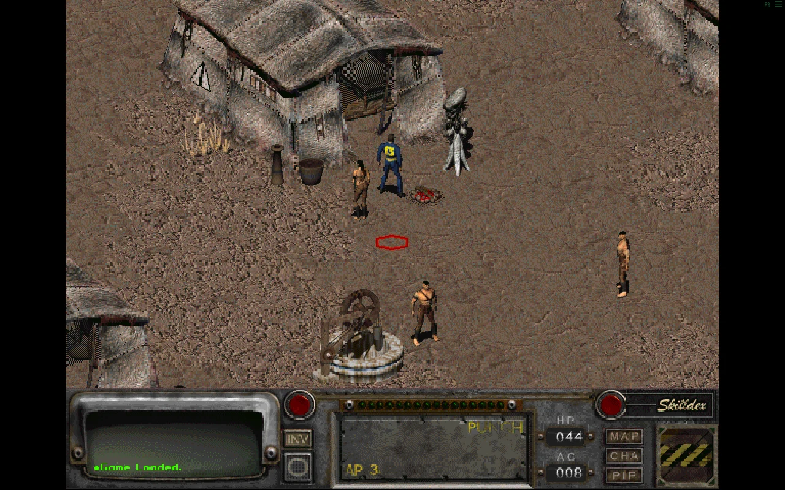
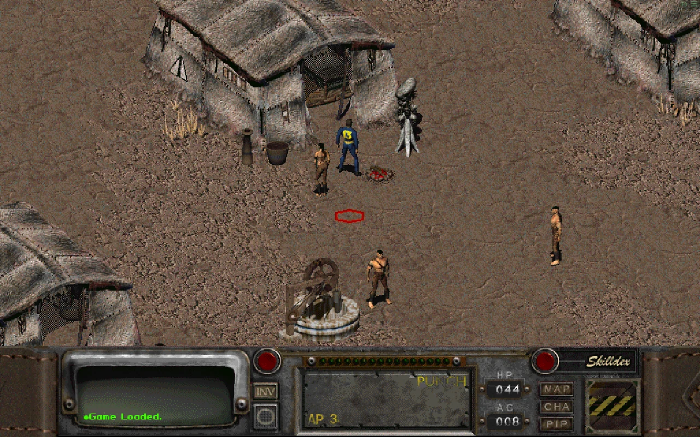
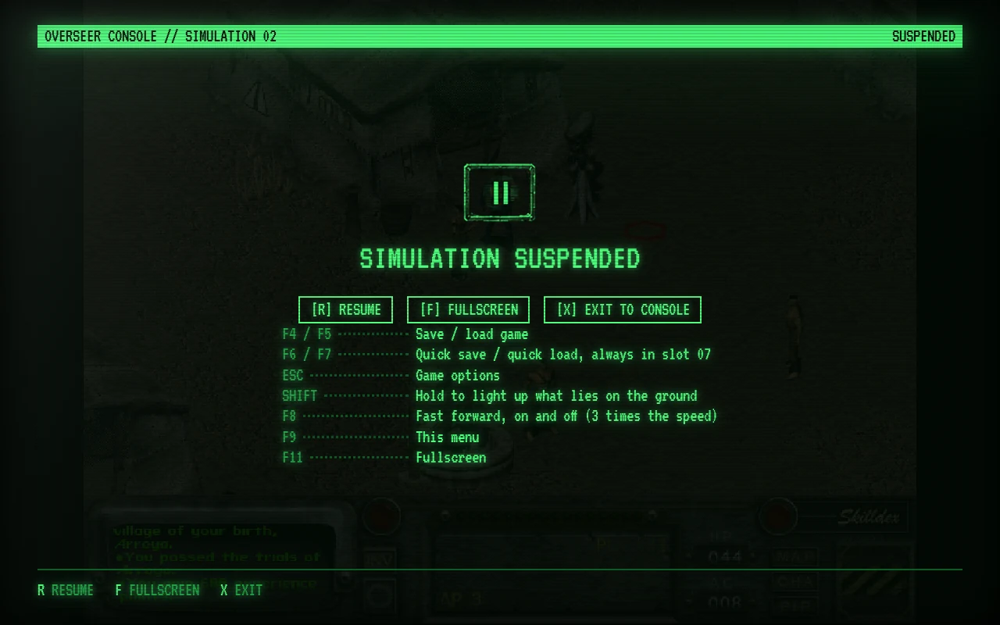

# Features

Everything the console does, in one place. For the short tour see the [README](../README.md); the console's
own **Operations manual** (entry 6 of the main directory) explains each of these from inside it.

- [The games](#the-games)
- [Mods](#mods)
- [Playing](#playing)
- [Touch screens](#touch-screens)
- [Saves](#saves)
- [Save archives](#save-archives)
- [Save editor](#save-editor)
- [The vault](#the-vault)
- [Privacy](#privacy)

## The games

- **Your own copy of the games.** No game data is hosted or distributed here. You need to own them
  ([GOG](https://www.gog.com/game/fallout), [Steam](https://store.steampowered.com/app/38400), Epic).
- **Fallout and Fallout 2**, played by the open source Community Edition engines, compiled to WebAssembly.
- **Games from a folder, a zip, or your cloud.** Pick the folder a store installed the game to, or drop it on the
  console. A game folder can also be loaded as one zip of it, which is how a whole game, music included, gets onto
  a device that cannot pick folders; or from your own Dropbox or Google Drive (see [Dropbox link](dropbox.md) and
  [Google Drive link](google-drive.md)), where the console puts it for you from another device.

## Mods

- **A Mod library.** Mods are played on the game they were made for, with saves of their own; the game stays as it
  was sold, one key away on its deck. See [Mods](mods.md).
- **Bring your own.** Hand the console a mod as it is downloaded (a zip or its folder) or a game folder it was
  installed in. It keeps only what differs from your game in the deck, and does what a mod's installer would do.
- **Add-ons.** Small mods with no game of their own (FO2tweaks, Party Orders, a talking head, music) loaded once and
  laid over a game or any of its mods, several at a time, switched on and off on its page: their archives join its
  load order, their loose data and music go where the engine reads them over its own. See [Add-ons](mods.md#add-ons).
- **Install a known mod.** Each of the nine at the version the console's tests play, from its makers' own link: a zip
  downloaded by your Dropbox into its Mods folder, or by your browser and checked when you hand it over; a 7z or an
  installer step by step, then its folder. A mod loaded at an older version is offered the newer one.
- **Nine it knows by name.** Fallout Et Tu (put together from your Fallout and played on your Fallout 2, no
  extraction tool), the Restoration Project, the Megamod, Sonora, Nevada, Olympus 2207, Resurrection and Fallout
  Yesterday for Fallout 2, Fallout Fixt for Fallout: where to get each, what to hand over, and how well it plays on the
  engine.
- **sfall's made-up traits and perks.** The Fallout 2 engine plays a mod's own traits and perks: on the character
  screen, offered in the perk box, and kept in saved games. Fallout Yesterday's hundred and more are made that way.
- **sfall's hook scripts and virtual files.** Fallout 2's engine runs a mod's `hs_*.int` hook scripts and lets its
  scripts make and change files the game then reads, kept in saved games where a script asks. It plays MP3 music
  and sounds too, as Fallout Yesterday has some.
- **sfall's Hero Appearance.** The look picked for your character, its race and style, in the Restoration Project
  and Fallout Yesterday: on the character screen as it is made, and in the game.
- **What mods reach for in the original program.** Fallout 2's engine answers for what mods are known to read, write
  and call in the original program's memory: Fallout Yesterday's traits, poison and stealing, Resurrection's skill
  points, Et Tu's Pip-Boy rest and Nevada's inventory filter. A mod's scripts are told they run on the sfall it came
  with.
- **sfall settings for Fallout.** Fallout's engine follows what a mod's `ddraw.ini` sets of sfall: Fallout Fixt's
  fixes, its faster game, the middle mouse button, and Shift or HILITE lighting up what lies on the ground.
- **A mod in its deck.** Put a mod in its game's deck and the deck plays it; switch back with one key.
- **Components.** The parts a mod's load order switches on, as its installer would offer them, switched on and off
  any time.

## Playing

<table>
  <tr>
    <td width="33%"></td>
    <td width="33%"></td>
    <td width="33%"></td>
  </tr>
  <tr>
    <td align="center">Classic 4:3</td>
    <td align="center">Wide</td>
    <td align="center">High resolution</td>
  </tr>
</table>

- **Continue.** One key takes you from the console straight into your latest save.
- **A picture for each game.** The original 640 x 480, widened to the shape of the window, or high resolution:
  chosen game by game and mod by mod. The two originals start at the picture they were drawn for, a mod at the one
  its makers meant: Fallout Et Tu at the high resolution it was laid out for.
- **Fast forward.** F8 runs a game several times as fast, for the long walk across a map and the turns of a
  dozen rats, and back again.
- **Fallout 2 with what its engine adds, or without.** One setting switches on items that light up on a key,
  a wider inventory, companions' own inventories, doors that open as you walk into them and more, for Fallout 2
  and its mods; switched off, the game plays as the original did.
- **A console menu over the game.** F9 freezes the game and its clock and opens the console's own menu:
  resume, fullscreen, back to the console, and the keys. Switching to another tab freezes it too.
- **Fullscreen.** F11, or from the F9 menu.

| Key | In the game |
| --- | --- |
| F4 / F5 | The game's own save and load screens |
| F6 / F7 | Quick save into slot 07, quick load from it |
| F8 | Fast forward, on and off |
| F9 | The console menu |
| F11 | Fullscreen |

## Touch screens

Tap, drag, press-and-hold and two-finger gestures stand in for the mouse, with on-screen mouse buttons,
one-tap shortcuts for the inventory, map, character screen, Pip-Boy, skilldex, the weapon's attack mode, the
end of a turn, quick save and quick load, a switch that keeps what lies on the ground highlighted, and a
keyboard that appears when a game asks for text. Inventories, containers and traders' goods scroll under a
swiping finger, as a phone's lists do.

## Saves

- **Saves as in the originals.** Saved games work as they always did, and can be exported to and imported
  from zip files.
- **Autosave.** Every ten minutes of play (or five, fifteen, thirty, or never) a game is saved by itself, in turn
  in slots 8, 9 and 10. The first six are the player's own, and so is any save made by hand in the last three.
- **Quick save in slot 7.** F6 saves into slot 7 at once and F7 loads it, without asking for a slot: on a touch
  screen they are two buttons beside the picture.
- **A history for every slot.** Saving over a slot keeps what was in it: every slot has earlier versions to
  roll back to. An erased save is kept for a week, and can be put back.
- **A reminder to back up.** Each game's deck and archive say when its saves last left the browser, to a zip file or
  to your cloud, and say it in amber while that has never happened.
- **A cloud link, if you want one.** Carry saves between devices, and games and mods to any of them, through your own
  Dropbox (2 GB free) or Google Drive (up to 15 GB free), one at a time. See [Dropbox link](dropbox.md) and
  [Google Drive link](google-drive.md).

## Save archives

They show each save's screenshot and character sheet, read from the save file itself, and name the place it
was made in as the game does, from the game's own data.

## Save editor

Change a saved character: name, level, S.P.E.C.I.A.L., skills and tags, traits, perks, hit points and what they
carry; karma, reputations, town standing, addictions and kills; the companions' hit points and packs; and what the
Pip-Boy keeps: the date, quests, holodisks, the places on the world map, Vault 13's water and the car's fuel, or
any of the game's global variables by name.

The game's own pictures (from your copy) are drawn in phosphor and its own rules applied (what a perk adds, what
a level brings, what curing an addiction takes back), freely or by the rules of its character screen. Quick
actions max a character out. Every change is listed and can be undone; the save it replaces is kept as an
earlier version.

<table>
  <tr>
    <td width="50%"></td>
    <td width="50%"></td>
  </tr>
</table>

## The vault

On a screen with room to spare the console stands in an abandoned vault: lamps that fail, a pipe that drips,
and now and then something that walks past. Most of it answers to being clicked, its great door is shut exactly
when the console's storage is sealed, and a console left alone gets a visitor on its glass.

Painted in the browser, one coarse pixel at a time, from nothing but code: no artwork from the games. It holds
still for those who have asked their system for less motion, and can be switched off in the settings.

## Privacy

**No server, no account, no tracking.** Game files and saves stay in the browser's private storage on your
device. Nothing is uploaded, unless you link your own Dropbox or Google Drive: then what you choose to upload (saves,
and the games and mods you put there) goes to a folder of the console's own there and nowhere else, and the link
reaches nothing else in your cloud.
